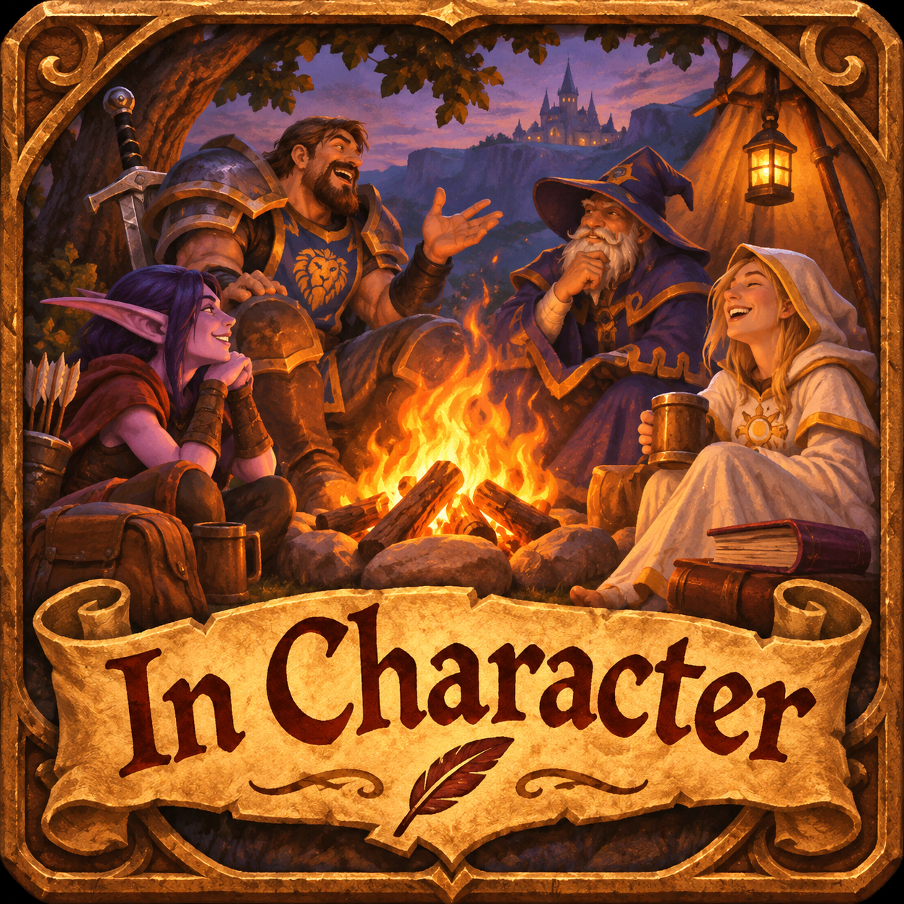

# In Character

<p align="center"></p>

Emotes and roleplay lines for **WoW Forever (interface 16001)**, kept small enough to stay out of the way while you play. Native Lua, no libraries.

## Install

Install it from [CurseForge](https://www.curseforge.com/projects/1798109) with your addon manager to get updates automatically, or download **InCharacter-0.15.2.zip** from [GitHub Releases](https://github.com/stronk-dev/wow_forever_mod_in_character/releases), or build it with `python3 scripts/package.py`. Extract it into:

```text
World of Warcraft/_forever_/Interface/AddOns/InCharacter/
```

`InCharacter.toc` must be directly inside that folder. Enable the addon, then `/reload`. Before upgrading, close WoW and back up both `WTF/.../SavedVariables/InCharacter.lua` files.

## Playing in character

Pick your RP character once. Every character shares the same **slots**: **Greeting**, **Quote** and **Farewell**, **Joke**, **Toast**, **Battle cry** and **Banter** (these four show up once your character or a shared pool has lines for them), plus any you add yourself (Pun, Sarcastic farewell, ...). A slot plays the loaded character's own pool for it, or, if the character has none, the **shared** pool for it. A preset character can be fully customised or lean on your shared lines, and you can mix both. Bars, the menu, the wheel, `/ic greet | quote | bye | joke | toast | battlecry | banter` and `/ic say <slot>` always use the slot, so switching character keeps your layout and only changes what is said. Buttons show the slot name; where a preset came from appears only as a dimmed line in the tooltip.

Switch character from the first row of the RP list (on the bar, in the menu or in the wheel), or with `/ic character <name>`. It lists the characters you made, then one row per preset family (The Office, Dutch politics, Dutch, World, Fundubs) that opens its characters. Preset characters follow the addon: updates add their new lines and slots, while your own rewordings, deletions and added lines stay. **Delete character** on the RP lines page removes one you no longer want.

## What you see while playing

| Surface | How it works |
| --- | --- |
| **Bars** | Choose **one bar** (favorites, the five emote categories as groups, and your RP character) or **separate bars** (favorites, one bar per category, and an RP bar). Each layout keeps its own positions. Bars are icons only, with no titles; tooltips name things. Click an emote to do it. Click a group to open its list. Click a slot or pool to say its next line; its small arrow (or right-click) lists the exact lines. |
| **Lists (flyouts)** | Open away from the screen edge, sized to their names. Pointing at a group or slot opens it beside the list and never sends; the tooltip appears on the other side, so it never covers that list. Right-click an emote or line to pin or unpin it as a favorite (gold `*`). Click elsewhere or press Esc to close. |
| **Launcher** | Left-click: emote menu. Right-click: settings. Shift-drag: move. Its tooltip names the character you're playing. |
| **Radial wheel** | Press its key: 7 slices under the cursor (Favorites, the five categories, your RP character). Point anywhere in a slice's direction; its full name appears beside the ring, never squeezed into the centre. Choosing a group zooms into it as its own ring (at most 8 slices; scroll pages). The centre goes back, or closes at the top. Only a click, or releasing the key in hold mode, sends. |
| **Emote menu key** | The same list as the launcher menu, opened at the cursor. |

Play controls work in combat; the client may still restrict chat or emotes. Settings and bar editing wait until after combat.

## Settings (`/ic`, Options → AddOns, or right-click the launcher)

- **Emotes & lists:** your lists on the left, what is in the selected list in the middle (Up / Down / Remove), and a searchable library on the right (every emote, a category, or your character's lines). Right-click a library row to add or remove it. Select an entry to try it, favorite it, rename it or change its icon. **Advanced** adds nesting one list inside another. Each emote sits in exactly one category.
- **RP lines:** choose or create the character you're playing. Edit its pools: name, **Used by** (only this character, or shared by all characters), **Slot** (Greeting / Quote / Farewell / your own / none; the same menu creates, renames and deletes your own slots), Say, Yell or Emote text, shuffle, random or in order, one line per row with a byte counter. Individual messages keep their button IDs when edited. **Play as this character** turns a preset (The Office characters, Dutch politicians, Mastermovies' Michael Nicht, Dutch sayings and everyday Dutch, and world characters: tavern regular, adventurer, merchant; see [LIBRARY.md](LIBRARY.md)) into your own editable copy.
- **Layout & keys:** one bar or separate bars, Move & edit bars, hide bars; the launcher (shown, size); the wheel (key, click or hold, which list, icon size); the emote menu (key, which list); favorite keys 1–4.
- **Profiles:** shared or per-character data and layouts, and reset.

**Move & edit bars** (`/ic edit`, Shift-right-click a bar, or Blizzard's Edit Mode where supported) tints every bar and shows its name *on* the bar. Drag to move. Click a bar and a small panel opens next to it with: one bar or separate bars, which list it shows, size, per row, vertical, names, hidden, locked, delete, + Bar, and Undo all. Drag the panel's header to place it anywhere; its position is saved with the active character/shared layout and stays put when selecting another bar or the launcher. **Follow bar** restores automatic docking. Leaving Edit Mode or entering combat stops settings, bar, resize and launcher drags. Clicks select here and never play anything. The addon uses Blizzard's `EditMode.Enter` / `EditMode.Exit` callbacks; addon layouts remain in its own SavedVariables.

## Emotes and icons

Which emotes exist comes from the running client; emotes it doesn't know are hidden on bars, wheel and menu but stay in your lists. Every emote has one icon chosen to match it (faces for moods, thumbs for yes/no, a chat bubble for talking, a toy train for /train). Pick your own from the detail panel at any time; your choice always wins.

## Commands

```text
/ic                       settings            /ic edit       move & edit bars
/ic wheel                 radial wheel        /ic menu       emote menu at the cursor
/ic bars                  hide / show bars    /ic lines      RP lines page
/ic bars one | separate   switch bar layout
/ic greet | quote | bye   your character's Greeting / Quote / Farewell
/ic joke | toast | battlecry | banter    the other built-in slots
/ic say <slot>            any slot by name, e.g. /ic say pun
/ic <pool>                a pool by name: your character's own first, then shared ones
/ic play random|shuffle|sequential <pool>     /ic character <name>
/ic message <pool ID> <message ID>            /ic help
```

If another addon owns `/ic`, use `/incharacter`. No keys are assigned automatically. Key Bindings → In Character lists: settings, wheel, emote menu, show/hide bars, move & edit bars, favorite 1–4.

## Safety and limits

- **Sends only on your input:** a click, a key or a slash command. There is no timed or automatic chat, no macro text, and no spells, items or targeting. Hovering never sends.
- **Message length:** lines are stored at any length. A line is sent only if it fits **255 bytes after pipe escaping**. Lines are never split or truncated.
- **Chat restrictions:** chat is submitted directly from your click or key action, following [Charades' send path](https://github.com/damesene/wow-charades/blob/main/Actions.lua). Permission checks are sampled at initialization, world entry, combat transitions and addon-restriction changes; the input handler reads that snapshot without invoking protected-call wrappers. The native chat API still enforces current restrictions. Playback commits only after the send returns successfully. A reported lockdown, explicit refusal, thrown error or synchronous blocked-action event leaves playback unchanged. Nothing is queued or retried. A nil API return is not a delivery receipt.
- **Upgrading to 0.15.1, once:** preset characters you already had become layers on their preset, so they get the new lines and slots. Lines you edited or added stay as your own; a preset line you had deleted from an old copy may come back once, because old copies kept no record of it.
- **Upgrading to 0.15, once:** the built-in categories get the new icons (only where you kept the default) and Playful loses Cheer, Laugh and Kiss, which live in Reactions and Greetings; new playful emotes your client knows are added.
- **Saved data:** `InCharacterDB` (shared) and `InCharacterCharDB` (per character).
- **Upgrading to 0.14 (schema 13), once:** lists earlier versions generated by themselves ("My wheel", "Wheel / …", "Menu / …", one copy per old bar) move out of sight into the save (`profile.retired.collections`), unless a list you made or your favorites point to one; those are kept as ordinary lists. The wheel and menu go back to the built-in lists. Old bars stay in the save, unused (`layout.retired`); the main bar keeps the old main bar's position, size and hidden state, and if you had no visible bars it stays hidden. Pool names that start with their exact preset title lose that "<preset> / " prefix once; names you type later are never changed. Each character's Greeting / Quote / Farewell slots are filled from its pools once; a slot you empty stays empty. Pools, lines, characters, favorites and your own lists are kept.

This addon manages its own buttons; it does not add spells, items, native action-bar drag/drop or custom audio broadcasting.

## Development

```sh
lua tests/run.lua && lua tests/ui.lua
luajit tests/run.lua && luajit tests/ui.lua
python3 scripts/verify.py && python3 scripts/package.py
lua scripts/layout_preview.lua > dist/InCharacter-layout.svg
lua tests/layout_probe.lua /tmp/ic-probe   # wireframe + findings for every surface
```

`tests/layout_probe.lua` loads the addon in the mocked client with the full emote catalog and a loaded preset character. It opens every surface (bars, flyouts, menu, wheel, Edit Mode, each settings page, popups), resolves every anchor, and writes a wireframe per state plus `report.txt` listing cut-off text, overlapping text and controls. Text widths are estimated and art is approximated: these are wireframes, not screenshots. [docs/UX_AUDIT.md](docs/UX_AUDIT.md) records the audit, the research into other addons and the decisions behind 0.14.

The shared collection model feeds every play surface. `Platform.lua` owns client integrations (chat, emotes, restrictions, tokens, bindings, cursor, Settings and Edit Mode); domain services use that boundary. Pure bar/menu models are in `Models/`, and the radial model is in `Services/WheelModel.lua`. `scripts/layout_preview.lua` renders their real dimensions to SVG without starting WoW. This is a geometry illustration, not an in-game screenshot. `scripts/gen_emote_catalog.py` regenerates `Data/EmoteCatalog.lua` from the wiki table. See [CONTRIBUTING.md](CONTRIBUTING.md). Original code is MIT. Third-party attribution is in `InCharacter/THIRD_PARTY_NOTICES.txt`. Quotes and Blizzard assets belong to their owners.
